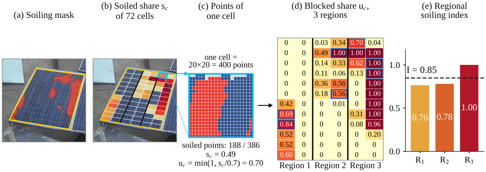
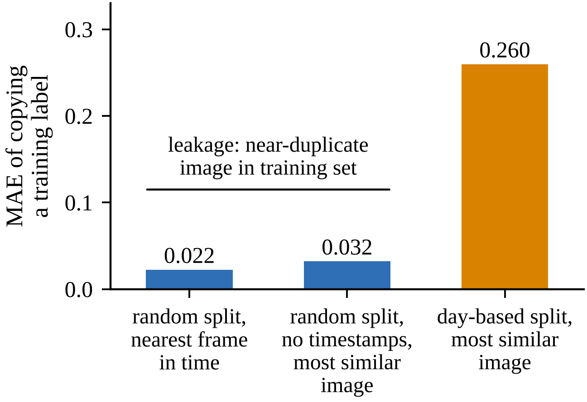
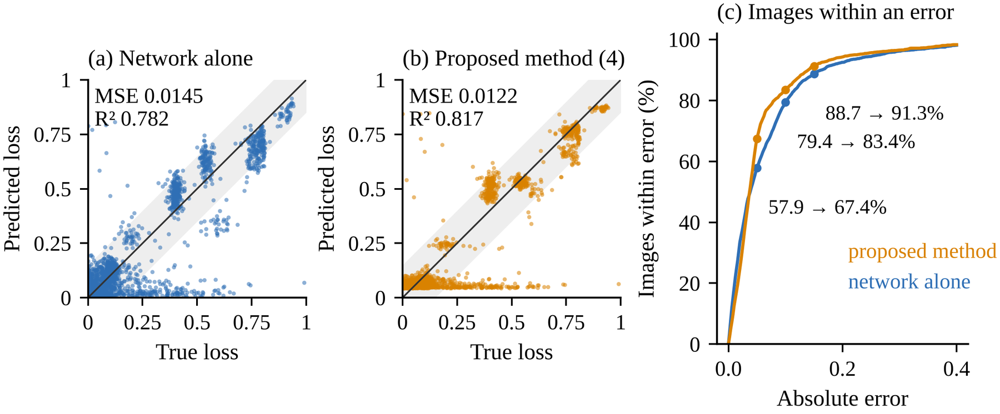

# PV Soiling Loss on Unseen Days

**Image-based estimation of the soiling power loss of a photovoltaic panel with a lightweight CNN and a regional soiling index, tested on whole days the model has never seen.**

Code, data splits, and model outputs for the paper

> Y. Fakhari, H. Hassanpour, and M. Zamen, “Image-Based PV Soiling Loss Estimation with a Lightweight CNN and a Regional Soiling Index,” *12th International Conference on Signal Processing and Intelligent Systems (ICSPIS)*, Shahrood University of Technology, Iran, 2026.

<p align="center"></p>

## Why unseen days?

DeepSolarEye stores a frame about every 5 s, so a random split of single images puts a near-duplicate of almost every test image in the training set. A rule that learns nothing and only **copies the label of the most similar training image** shows how much this helps:

| Split | Copy rule | MAE | MSE |
|---|---|---|---|
| Random split of single images | training image closest in time | 0.022 | – |
| Random split, timestamps removed | most similar training image, pixels only | 0.032 | – |
| Random within 20-point loss ranges (12 days, mean of 10 draws) | most similar training image, pixels only | – | 0.0018 |
| **Day-based split (this work)** | most similar training image, pixels only | **0.260** | – |

On an image-level split, copying already reaches an MSE below every published DeepSolarEye result we found. We therefore keep **whole days apart**: June 15, 24, and 30 are test days, June 22 and 27 validation days, and the other ten days training days.

<p align="center"></p>

## Method

One camera image, two estimates, one weighted sum:

1. **Network.** MobileNet v1 (3.4 M parameters, ImageNet start) reads the 192×192 image; the solar irradiance joins the 1,024 image features before two dense layers (128 and 32 units) and a sigmoid output. Training: cleaned labels, label-distribution-smoothing weights, C-Mixup between images with similar losses, Adam with a cosine schedule for 10 epochs, and weight averaging of epochs 8–10.
2. **Regional soiling index *I*.** Image processing only: fit the panel edges, mark a pixel as clean when its blue channel is at least its red and green channels and its saturation exceeds 0.55 of the clean reference panel, remove thin lines by a 3×3 opening, grow the soiling to the frame, measure the soiled share of each of the 72 cells, and average the two most soiled cells of each of the three cell strings.
3. **Formula** (fitted on the training days): *L*<sub>f</sub> = 0.638 *I* + 0.221 *I σ* + 0.061, where *σ* = max(0, sin(π(*h* − 6)/12.5)) is a sun factor of the hour *h*.
4. **Combination**, with weights set on the validation days by the inverse of each estimate's MSE (network 0.0275, formula 0.0129):

   *L* = 0.3 *L*<sub>net</sub> + 0.7 *L*<sub>f</sub>

## Results on the three unseen test days

| Estimate | MSE | R² | bMAE | MSE, clean test set |
|---|---|---|---|---|
| Network with C-Mixup | 0.0145 | 0.782 | 0.110 | 0.0054 |
| Formula (3) alone | 0.0125 | 0.811 | 0.092 | 0.0040 |
| **Proposed method (4)** | **0.0122** | **0.817** | **0.090** | **0.0034** |

The proposed method lowers the MSE by 16% on all 2,262 test images (95% interval 7–25%, bootstrap over 58 half-hour blocks) and by 38% on the 1,913 images with stable labels, and it lowers the MSE on each of the three test days.

<p align="center"></p>

## Repository layout

```
train_network.py               train the MobileNet v1 network (final model, extra seeds, 10-day validation model)
ne/                            training code: data pipeline, model, losses, evaluation, regional soiling index
scripts/compute_index.py       regional soiling index, sun factor, and soiled area for every image
scripts/fit_formula.py         index-to-loss formula (3) and its leave-one-day-out error
scripts/combine_and_evaluate.py  combination weights from the validation days and every test number of the paper
scripts/leakage.py             copy rules on random, loss-range, and day-based splits
splits/                        day-based split: 10-day (splits_v5) and 12-day (splits_v5_trainval) versions,
                               cleaned training labels, clean test subset, and panel_features.csv
outputs/final_network/         trained network (model_swa.keras) and its test predictions
outputs/validation_network_10days/  validation-day predictions used to set the weights
outputs/formula/               fitted coefficients
outputs/proposed_method/       final test predictions and metrics.json
docs/                          figures of the paper
```

## Reproduce the numbers

**Without the images** (uses the predictions and the index stored in this repository):

```bash
pip install -r requirements.txt
python scripts/fit_formula.py            # L_f = 0.638 I + 0.221 I*sigma + 0.061
python scripts/combine_and_evaluate.py   # weights 0.3 / 0.7, MSE 0.0122, R2 0.817, clean MSE 0.0034, ...
```

**From the images:** download DeepSolarEye from the [project page](https://deep-solar-eye.github.io) and put the images in `dataset_raw/PanelImages/` next to this repository (or pass `--data-root`). Then:

```bash
python scripts/compute_index.py --data-root dataset_raw        # rewrites splits/panel_features.csv
python train_network.py --runs final_s42 --data-root dataset_raw
python train_network.py --runs val10_s42 final_s7 final_s123 --data-root dataset_raw   # optional
python scripts/leakage.py --data-root dataset_raw
```

The images themselves are not included; they belong to the DeepSolarEye authors.

## Limitations

All images come from one panel, one camera view, one site, and one month, and only three days are held out for testing, so the results may not hold for other panels or seasons. The hardest images are those whose loss is far larger than their soiled area: they are 30% of the clean test set but cause 61% of its squared error.

## Citation

If you use the code or the day-based split, please cite the paper (see `CITATION.cff`) and the DeepSolarEye dataset:

> S. Mehta, A. P. Azad, S. A. Chemmengath, V. Raykar, and S. Kalyanaraman, “DeepSolarEye: Power loss prediction and weakly supervised soiling localization via fully convolutional networks for solar panels,” *Proc. IEEE Winter Conf. Applications of Computer Vision (WACV)*, 2018.
